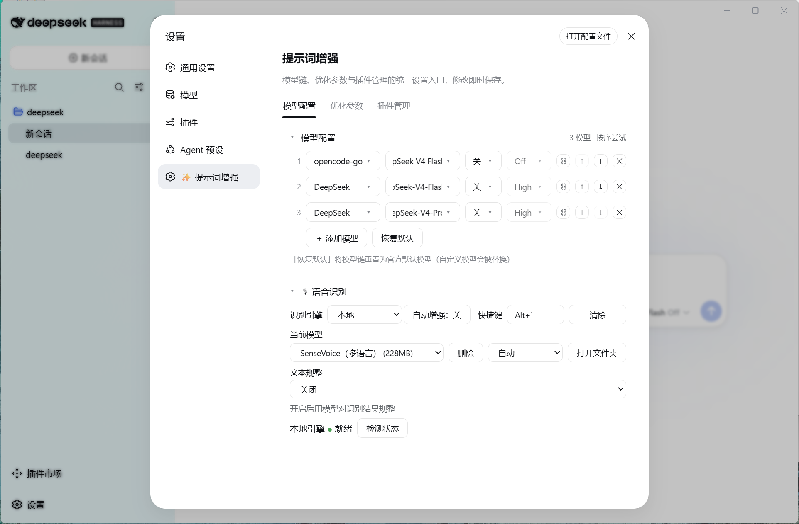

# dsh-prompt-enhancer

A DeepSeek Harness (DSH) plugin with **two core capabilities**:

- ✨ **Prompt enhancement** — rewrite composer drafts in place with one click, fully undoable
- 💬 **Voice recognition** — stops on silence; transcription is provided by the official `speechToText` service, and the transcript is filled into the draft

[](https://github.com/Fishsb/dsh-prompt-enhancer/releases)
[](https://github.com/Fishsb/dsh-prompt-enhancer/releases)
[](https://github.com/Fishsb/dsh-prompt-enhancer/stargazers)

## ✨ Two core features

### 1. Prompt enhancement (✨)

The ✨ button in the composer toolbar triggers an independent LLM call and rewrites the current draft in place; keep refining, undo anytime, or cancel while enhancing.

- **One-click enhance** — the ✨ button triggers an independent LLM call and replaces the draft; continue refining, undo anytime, cancel while enhancing
- **5 optimization modes** — Basic (direct) / Lite (previous-round context) / Standard (rules + retrieval) / Expert (task analysis + full retrieval) / One-click Publish (complete dev-spec generator)
- **Memory switch** — when on, pre-send rounds (optimize → edit → re-optimize) accumulate into a memory chain the next round replays and senses your edit direction; sending the message clears it; when off, nothing is read or written
- **Model chain** — try multiple models in order, reorder, toggle thinking, run inline connectivity tests

### 2. Voice recognition (💬)

Use the official 🎤 record button (or this plugin's hotkey) to start listening; the transcript (produced by the official `speechToText` service) → optional refinement (de-filler) → filled into the draft → can be enhanced with one click. **Stops automatically on silence** (VAD), audio stays in memory only and is never written to disk.

- **Transcription delegated to the official service** — the recognition engine and models come from DSH's official `speechToText` (including its settings page); the plugin ships no engine and downloads no models (slim release)
- **Stops on silence** — VAD silence detection, no manual stop needed (auto-stops after at most 60 seconds)
- **Hotkey wake** — recordable global hotkey, tap / long-press dual trigger
- **Transcript refinement** — optionally refine the transcript through the base LLM to remove filler words
- **Auto-enhance** — when on, filling the draft after recognition automatically triggers prompt enhancement

## 🔧 Other capabilities

- 🌐 **i18n** — follows the DSH interface language (中文 / English)

## 🚀 Install

```sh
dsh plugin --profile web add github:Fishsb/dsh-prompt-enhancer#v3.4.2
```

Restart DSH (`dsh web`) after installing — the ✨ button appears in the composer toolbar.

> ℹ️ **Version note**: the latest tag **`v3.4.2` (2026-10-09)** contains the **Windows platform fix** — it fixes the host **silently exiting about 5 seconds after start** on Windows (the worker process scan treated every node process on the machine — including the host itself — as a worker to reap, so the host killed itself; the UI then sat on "reconnecting" forever). The command above installs that tag.
>
> Earlier releases: **v3.4.1** (2026-10-06) contains the **DSH 0.2.x compatibility fix** — it fixes the plugin being rejected at load time by the host's compatibility gate on DSH `0.2.0` and later, which made ✨/🎤 and the settings card disappear entirely (Issue #11 / #12). If you previously installed `#main` under the old note, re-running the command above pins you to a released version.
>
> Older: **v3.4.0** (2026-09-19) added the ✨ official slot-contract fix (Issue #8 / #10) and the cloud ASR fix (Issue #9), and **removed the in-plugin restart capability** (restart DSH manually after an update) — see [release notes](release-notes/3.4.0.md).
>
> Requires [DeepSeek Harness](https://github.com/deepseek-ai/deepseek-harness) installed locally and `pnpm` in PATH.
>
> **Client compatibility (voice recognition)**: 🎤 voice input relies on the client injecting `inputActions.setDraft` (the official web client satisfies this); third-party clients implementing the same contract can load it, and when the capability set differs, voice input **degrades gracefully** (no insert capability → transcript appended to the end of the draft; no injection at all → 🎤 disabled with a notice). **The recognition engine and models are delegated to the official `speechToText` service**: the plugin itself ships **no engine** and **downloads no models**; choosing and obtaining engines/models happens in the official voice settings. See [compatibility notes](docs/compatibility-matrix.md) (client dependency boundary and slot contract).
>
> **Composer toolbar (✨/🎤) client contract**: the composer buttons and the error strip mount on the session-scoped slots `conversation.input.right` / `conversation.input.dock`. The official renderer (`@deepseek-ai/dsh-client-ui-renderer` ≥ 0.1.2-rc.1; web and DSH Desktop share the same source) injects **a `sessionId` prop, `useSession`/`useInput` selector hooks, and an `inputActions` prop** into slot entries (it never provides `props.session` / `props.input`); the plugin reads state through that contract since that fix (Issue #8 / #10, commit `0197ae7`, released with `v3.4.0`) and keeps a fallback for older hosts that provide the `props.session` / `props.input` shape. Third-party client renderers must implement the same contract (`sessionId` plus the hooks and actions above) for ✨/🎤 to render.

Update / remove:

```sh
dsh plugin --profile web update dsh-prompt-enhancer
dsh plugin --profile web remove dsh-prompt-enhancer
```

> After `remove`, restart DSH to fully unload the running instance.
>
> After an update is installed, restart DSH manually for it to take effect (the plugin no longer restarts DSH for you).

## 📦 Library notes

Core logic lives in standalone Node modules, reusable from other scripts: `lib/platform-service.cjs` (cross-platform service management), `lib/sys.cjs` (env & paths). See each module's header comments.

> P1-c (2026-10-13): the former `lib/updater-host.cjs` (the plugin's own update executor: download / verify / install / rollback) **has been retired** — plugin updates now go through the official plugin manager (see "Update / remove" above).

## 🎯 Usage (prompt enhancement)

1. Type any non-empty text (slash commands keep their prefix; only the body is optimized)
2. Click the **✨** button
3. Wait for the independent LLM call; the draft is replaced with the enhanced version
4. Not satisfied? Click **Undo** to restore the original

## 📸 See it work

**Voice recognition** (the 🎤 record button, stops on silence):


**Voice recognition settings** (hotkey wake / silence auto-stop / refinement / auto-enhance):



## ⚙️ Configuration

Settings → "Models & plugins" (since P1-c there are **only the "Model configuration" / "Optimization parameters" tabs** — the former "Plugins" tab is retired; plugin version management is back to the official plugin manager):

| Tab | Description |
|---|---|
| **Model configuration** | Configure the optimization model chain: tried in order, reorderable; the **Voice recognition** section (hotkey wake / silence auto-stop / refinement / auto-enhance) |
| **Optimization parameters** | Mode / memory switch / context budget / timeout & output limits / templates |

## 📚 Docs

- [Releases](https://github.com/Fishsb/dsh-prompt-enhancer/releases)
- [CHANGELOG](CHANGELOG.md)
- [Compatibility notes](docs/compatibility-matrix.md)

> Privacy: the plugin records or reports nothing; enhanced results come from an external LLM — verify before sending.
