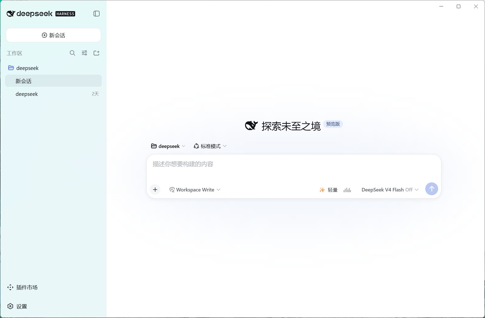

# dsh-prompt-enhancer

DeepSeek Harness（DSH）插件：**提示词优化** + **语音输入增强** —— 把输入框草稿改写得更清晰、可执行，并给语音输入加上热键、说完自动停、清口水词与纠错。

草稿常常只有半句要求，交给模型后还要来回补问——点一下 ✨ 就地改写，不满意可撤回；语音则直接说，停顿即停，结果落回输入框。

[](https://github.com/Fishsb/dsh-prompt-enhancer/releases) [](https://github.com/Fishsb/dsh-prompt-enhancer/stargazers)

## 安装

```sh
dsh plugin --profile web add github:Fishsb/dsh-prompt-enhancer#v3.4.2
dsh plugin --profile web update dsh-prompt-enhancer   # 更新
dsh plugin --profile web remove dsh-prompt-enhancer   # 卸载
```

装完（或更新 / 卸载后）重启 DSH，输入框工具行出现 ✨ 即安装成功。需本机已装 [DeepSeek Harness](https://github.com/deepseek-ai/deepseek-harness) 且 `pnpm` 在 PATH 中。

## 能做什么

**提示词优化**

- ✨ **一键优化** — 改写当前草稿，可继续优化、可撤回、优化中可取消
- **5 种模式** — 基础 / 轻量 / 标准 / 专家 / 一键发布
- **记忆开关** — 发送前的多轮优化累积为记忆链，发送即清空（默认关）
- **模型链** — 多个模型按序尝试，可增删改序、开关思考、行内测连通性

**语音输入增强**（识别由 DSH 官方 `speechToText` 提供；插件不自带识别引擎、不下载模型）

- **两种入口** — 官方 🎤 按钮，或插件热键（点按开始 / 再按停止；长按 = 按住说、松开停）
- **静音监测** — 说完自动停，判定时长 1–5 秒可调（默认 2 秒），可整体关闭
- **清口水词** — 本地规则清理语气词 / 重复 / 拖音，不改写、不新增（默认开）
- **语音纠错** — 识别完成后做字词层订正，仅作用于语音路径（默认关）
- **自动增强** — 识别结果填入草稿后自动触发增强（默认关）

按钮与文案跟随 DSH 界面语言（中文 / English）。

## 设置项速查

设置 →「提示词增强」，改动即时保存：

| 位置 | 内容 |
|---|---|
| 模型配置 | 模型链；语音识别：热键、静音监测（1–5 秒）、清口水词、语音纠错、自动增强 |
| 优化参数 | 优化模式、模板、记忆开关、上下文预算、超时 / 回复长度 / 输出上限 |

录音采集、识别与写回都由 DSH 官方语音控件完成，插件只叠加上述增值。录音不落盘。



[Releases](https://github.com/Fishsb/dsh-prompt-enhancer/releases) · [CHANGELOG](CHANGELOG.md) · [兼容性说明](docs/compatibility-matrix.md)

> 隐私：插件不记录、不上报任何数据；增强结果来自外部 LLM，发送前请自行核对。
